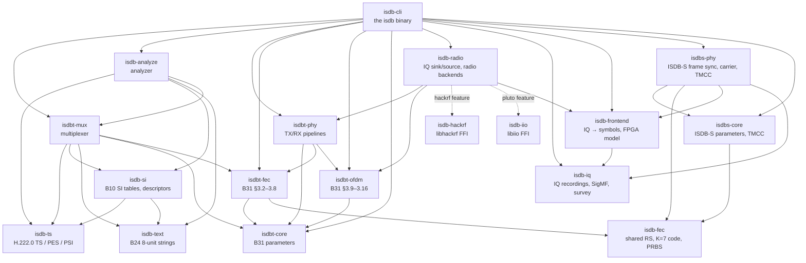

# Architecture

This page describes how the crates fit together, how data flows through
the transmitter and the receiver, the frame and latency contract between
them, and the design rules that keep every layer independently
verifiable. Per-crate details (entry points, examples, tests, limitations)
are in each crate's README.

## Design principles

- **The specifications are the only ground truth.** Code is written from
  ITU-T H.222.0 and the ARIB standards ([SPECS.md](../SPECS.md)); every
  public item's doc comment names the clause or table it implements. Other
  implementations (GNU Radio gr-isdbt, FFmpeg, …) are never copied or used
  as references. They serve only as independent oracles, run as separate
  programs in differential tests, and a disagreement is resolved by reading
  the spec. Readings of ambiguous text are recorded in the crates'
  `SPEC-NOTES.md` ([index](../SPEC-NOTES.md)).
- **Lossless codecs, separate conformance.** Decoders keep every bit —
  reserved bits, stuffing, raw bytes the syntax does not describe — and
  encoders recompute lengths and CRCs, so `encode(decode(x)) == x` for
  anything that decodes. Whether a field *value* is allowed (reserved bits
  set to '1', table_id allowed on a PID, repetition rates, value ranges) is
  checked by separate validators (`check` functions, `isdb_si::conformance`,
  `isdb_analyze::validate`). A capture that violates the spec can still be
  decoded, edited and re-encoded byte-identically, and the validator
  reports the violation instead of the decoder failing.
- **Generator and checker share no code.** `isdbt-mux` builds streams;
  `isdb-analyze` checks them using only the decoders. Neither reuses the
  other's packing or timing logic, so they cannot share a bug.
- **Everything is clocked by the OFDM frame.** The multiplexer, the
  transmitter and the receiver all work in whole OFDM frames (204 symbols)
  with exactly known packet counts and latencies.
- **No panics on malformed input** in decoders; no `unsafe` outside the
  `isdb-hackrf` and `isdb-iio` FFI crates.

## Crate graph



Arrows point to dependencies. The TS/SI side (`isdb-ts`, `isdb-text`,
`isdb-si`, `isdbt-mux`, `isdb-analyze`) and the PHY side (`isdbt-core`,
`isdbt-fec`, `isdbt-ofdm`, `isdbt-phy`) meet in only two places: `isdbt-mux` uses `isdbt-core` and
`isdbt-fec` for the frame clock and the §3.2 multiplex-frame slot pattern,
and `isdb-cli` wires everything together. `isdb-radio` is the only
crate that knows about radios: it defines the device-neutral `IqSink` /
`IqSource` traits, the `--radio NAME[:key=value,...]` device selection,
the `RadioConfig` / `TxOptions` / `RxOptions` handed to a backend, the
`QueuedSink` transmit path shared by every backend with integer samples,
and the registry of backends, each behind its own cargo feature
(`hackrf` → `isdb-hackrf`, `pluto` → `isdb-iio`, the FFI wrappers).
The CLI never names a device. `isdb-iq` stands apart from both sides:
IQ recordings of any system (sample formats, SigMF metadata) and the
survey of a single-carrier recording, used by `isdb capture` and `isdb iq
survey`; the radio's raw captures (`Backend::capture`) reach it only
through the CLI. `isdb-frontend` is the first stage of the satellite
receivers (IQ to symbols): a bit-exact fixed-point model whose FPGA
implementation lives in `fpga/` (Amaranth, outside cargo). `isdb-radio`
depends on it for the stages a radio can run itself (`Offload`,
`Backend::capture_symbols`: the FPGA's discovery and configuration
words), and `isdb symbols` picks the FPGA or the CPU at run time.
`isdb-fec` holds the channel-coding blocks both systems use (the RS(255,239)
shortened codes, the K = 7 code with its Viterbi decoder, the PRBS
generators); `isdbt-fec` re-exports them under its old paths.
`isdbs-core` (ISDB-S parameters and the TMCC codec) and `isdbs-phy`
(frame sync, carrier recovery and TMCC decoding on the front end's
symbols) are the ISDB-S receiver so far; `isdb iq tmcc` drives them. The PHY crates carry TS packets
as plain `[u8; 188]` and do not depend on `isdb-ts`. `isdb-analyze` uses
`isdbt-mux` only for the ARIB STD-B32 Part 2 ADTS rule identities and
quality modes; it parses ADTS headers itself.

## Data flow

```text
                       ┌──────────── isdb-ts / isdb-text / isdb-si ────────────┐
                       │  lossless codecs: packets, PES, sections, SI, strings │
                       └───────▲──────────────────────────────────────────▲────┘
                               │ builds with                 decodes with │
TX                             │                                          │
 TOML + media ─► isdbt-mux::Multiplexer::next_frame()                     │
   (or per-layer TS files / PID split / synthetic, in isdb-cli)           │
        │  [Vec<Packet>; 3]: exactly tsp_per_frame 188-byte TSPs per layer│
        ▼                                                                 │
 isdbt-phy::Transmitter::transmit_frame   (one call = one OFDM frame)     │
        │  isdbt-fec::LayerEncoder  §3.3–3.8                              │
        │    RS(204,188) → energy dispersal → delay adj. → byte interleave│
        │    → convolutional code + puncturing          ⇒ coded bits (u8) │
        │  isdbt-ofdm::Modulator    §3.9–3.16                             │
        │    delay adj. + bit interleave + mapping → layer combining      │
        │    → time / frequency interleave → SP/CP/TMCC/AC frame          │
        │    → IFFT + guard interval                   ⇒ C32 @ 512/63 MHz │
        ▼                                                                 │
 isdb_radio::IqSink: IQ file (cf32 / cs8)  or  radio backend (e.g. cs8)   │
                                                                          │
RX                                                                        │
 isdb_radio::IqSource: IQ file  or  radio backend                         │
        │                                                                 │
 isdbt-phy::Receiver / PipelinedReceiver::push(samples)                   │
        │  isdbt-ofdm::Demodulator: sync, CFO, channel estimation,        │
        │    TMCC decode → Params, inverse chain   ⇒ DemodFrame (f32 LLRs)│
        │  isdbt-phy::FrameDecoder → isdbt-fec::LayerDecoder:             │
        │    depuncture + Viterbi → byte deinterleave                     │
        │    → energy de-dispersal → RS decode     ⇒ per-layer TSPs       │
        │  isdbt-fec::MultiplexPattern::reproduce_ts  (§3.2.2 model       │
        │    receiver: multiplex frame with null TSPs in unused slots)    │
        ▼                                                                 │
 RxFrame { tx_frame, valid, layers, ts, tmcc, metrics, rs }               │
        ▼                                                                 │
 TS file ─► isdb-analyze (scan → inspect / validate / diff / edit) ───────┘
```

`isdbt-core` (parameters and spec tables) is used by every PHY crate.
Soft bits between the demodulator and the FEC decoder are `f32` LLRs,
`ln P(b=0)/P(b=1)` (positive means 0, 0.0 for erased positions); coded bits
are `u8` 0/1; samples are `Complex32` at 512/63 MHz.

### The multiplexer

`isdbt-mux` models packet arrival as the multiplex-frame slot: slot *j* of
OFDM frame *k* starts at sample clock `k·samples_per_frame + 408·j`
(512/63 MHz), converted to the 27 MHz system clock by ×1701/512. PCR
values and the PTS/DTS schedule are therefore consistent with the
transmitted rate by construction. Each slot is filled by priority: a PCR
packet at its fixed position (1/2/4 per frame in Mode 1/2/3), then a due
section packet (earliest deadline first, within B10's 4 KB per 32 ms
limit), then a PES packet the H.222.0 T-STD model can accept (earliest DTS
first), else a null packet. Sections are regenerated at 0.9 × their B10
Table 5-2 interval; a content change bumps version_number. Values ARIB
derives from the transmission parameters (delivery-system guard interval
and mode codes, partial reception descriptor, PCR count, packets per
layer, PMT layer) are derived, not configured.

A `ts-program` relay adds a reader thread per recording: each source
packet's time is interpolated from the recording's PCR, shifted by a
constant (a multiple of 300 ticks, so PTS/DTS move by an exact 90 kHz
constant), and sent in the first free slot of its layer from that time on.
The relay passes only unscrambled packets (transport_scrambling_control
'00') and refuses scrambled input; nothing is descrambled. By default the
relayed service keeps the source's digital copy control and its
CA_descriptor/ECM (`ca = "keep"`; `"drop"` removes them on request), and an
explicitly relaxed copy control is reported together with the source value.

A `bml-carousel` stream is a section stream like the SI tables: its files
are packed into DSM-CC modules at start (one `multipart/mixed` entity per
module with the resource list, or one file per module), the DII and the
DDBs of one cycle form the section list, repeated at the configured cycle
with the DII re-inserted at its own interval, and the PID is rate-limited
over the same 32 ms window as the SI. `[service.hybridcast]` adds the AIT
either as a resource of that carousel (with a generated `startup.bml`
launcher) or as a further section stream on its own PID.

### The CLI

```text
tx:  reader thread(s) ─packets (bounded, ~2 s)─► producer thread
       (per-layer files / PID split (PCR-paced for files) /
        in-process isdbt-mux (its ts-program relays have their own
        reader thread) / synthetic; feed policy)
     producer: Transmitter (pre-roll, lead, data, finish + flush)
       ─frames (bounded, --queue-frames 4)─► main thread: dyn IqSink
     IqSink: file sink (cf32/cs8)
           | isdb-radio backend (Backend::open_tx), e.g. hackrf:
             QueuedSink: cs8 quantiser → buffer queue → libhackrf TX
             callback (starts after --prefill-frames 2; back-pressure
             paces the producer; stall detection, drain on finish);
             pluto: the same QueuedSink with a cs12 quantiser → the
             isdb-iio TX thread (iio_buffer_push)
rx:  dyn IqSource: file
           | isdb-radio backend (Backend::open_rx), e.g. hackrf:
             libhackrf RX callback → buffer queue (RxOptions: 1 s)
             → cs8 → C32; pluto: isdb-iio RX thread (iio_buffer_refill)
             → buffer queue → 12-bit → C32
       ─► PipelinedReceiver
       (demod thread ─► FEC-decode thread) ─► outputs + status
loopback: producer ─► software channel ─► PipelinedReceiver ─► verifier
```

`isdb-cli` adds I/O, threading, pacing, the `--rf-enable` / `--dry-run`
gate and reporting; no spec logic and no device code lives there. Before
transmitting or receiving it prints the backend's `describe_tx` /
`describe_rx` text (which validates the frequency range, sample rate,
device arguments and `--gain NAME=VALUE` values without opening the
device) and, once the device is open, the backend's "opened:" line.

## Frame and latency contract

Everything is clocked by the OFDM frame (204 symbols; 231.336 ms in Mode 3,
GI 1/8).

- **Input.** Per frame and active layer, the multiplexer delivers and the
  transmitter consumes exactly `tsp_per_frame` TSPs (ARIB STD-B31 Table 3-3
  × segments; for the 13-segment TS, the §3.2 multiplex frame of Table 3-5
  slots).
- **Modulator.** The modulator holds one frame (B31 Part 2 Fig. 3-8
  one-frame buffer for the 2-symbol bit-interleave advance): the call that
  receives input frame `k + 1` emits on-air frame `k`, so the first emitted
  frame is on-air frame −1. After the bit deinterleaver, data-frame symbol
  `s` is OFDM-frame symbol `s`.
- **Demodulator.** It outputs the LLRs of data frame `m − L` together with
  on-air frame `m`, where `L = isdbt_ofdm::latency::latency_frames` is the
  largest Table 3-12 delay of the active layers; layers with less time
  interleaving are aligned by a receiver FIFO.
- **FEC.** The encoder/decoder pair adds exactly one frame
  (`isdbt_fec::layer::LATENCY_FRAMES` = 1: §3.6 delay adjustment plus byte
  interleaving). Energy dispersal and puncturing restart at every OFDM
  frame.
- **Result.** `RxFrame::tx_frame = frame_number − L − 1`, counted from the
  frame at which the receiver locked, and `RxFrame::valid` turns true once
  every deinterleaver is primed.
- **Stream boundaries.** `Transmitter::preroll` modulates and discards
  `1 + L + 1` frames, so the first emitted frame is ordinary OFDM rather
  than the delay lines' start-up fill (which would also produce clipping
  peaks in an 8-bit DAC). `lead_frames` (2) null frames let a receiver that
  locks one frame late still output every packet, and `flush_frames`
  (`1 + L + 1 + 1`) null frames after the data push the last packets
  through the interleavers and the receiver's channel-estimation
  look-ahead.

The reasoning, with the quoted spec text, is the cross-crate entry in
[SPEC-NOTES.md](../SPEC-NOTES.md#cross-crate-decision-ofdm-frame-alignment-b31-part-2-figs-3-83-9);
the gr-isdbt oracle applies the same 2-symbol alignment and cross-decodes
byte-exactly with it.

## Verification ladder

Each layer is verified without trusting the implementation itself; the
higher rungs are progressively more independent:

1. **Spec vectors** — numbers printed in the specs (CRC check values,
   tables, PRBS initial states, constellation points, frame lengths, TSP
   counts) asserted directly; tests are named `spec_<table>_…`.
2. **Lossless round trips** — `encode(decode(x)) == x`, property-tested
   (`prop_…`, proptest) on generated structures and on arbitrary bytes, and
   run over synthetic multiplexes and, optionally, every section of a real
   capture.
3. **Inverse pairs** — every TX stage against its RX inverse
   (interleavers, mappers, codes, TMCC), then the whole PHY as TX →
   impairments (AWGN, CFO, sample offset, clock offset, echo) → RX,
   byte-exact; the CLI repeats it end to end (`isdb loopback`).
4. **Independent oracles** — gr-isdbt as a separate program: Rust TX
   decoded by gr-isdbt and gr-isdbt TX decoded by Rust, byte-exact in 8
   parameter sets, plus a carrier-level comparison of the two modulators;
   ffprobe for the multiplexer's media streams.
5. **Real data and receivers** — your own captures through the opt-in
   tests ([test-data.md](test-data.md)); consumer receivers fed the Rust
   transmitter over a conducted link
   ([transmitting.md](transmitting.md#receiver-compatibility-notes)).

Results and reproduction: [VERIFICATION.md](../VERIFICATION.md). Which
clause is confirmed at which rung: [SPECS.md §2](../SPECS.md#2-coverage-matrix).
